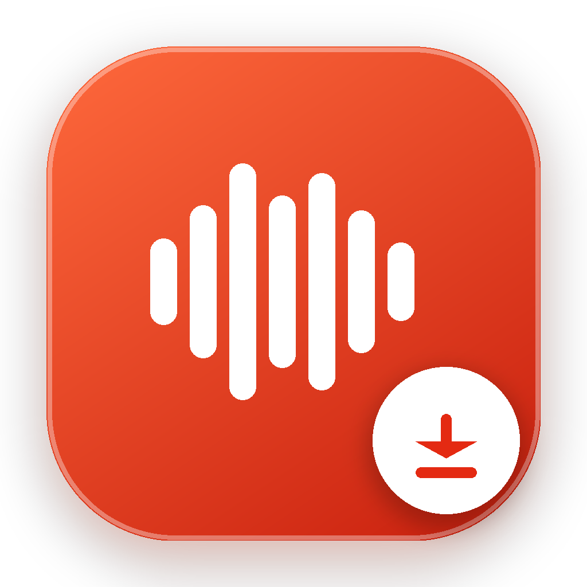

# 喜马拉雅音频下载器 (Ximalaya Downloader)

<p align="center">
  
</p>

<p align="center">
  <b>纯绿色单文件 · 免鉴权满速直链下载 · 贴心防闪退交互 · 支持 Windows 全平台</b>
</p>

---

## 🌟 项目亮点

1. **无需配置运行环境**：
   - 仓库内已内置编译完成的单文件绿色版 `XimalayaDownloader.exe`（9.2MB），拷贝至任意 Windows 电脑直接运行，无需安装 Python 或任何第三方包。
2. **免鉴权满速直链与原生 MP3 格式**：
   - 绕过 PC 端容易触发 407 Proxy Authentication Required 的防爬拦截机制，优先通过官方移动端 baseInfo 接口直接提取腾讯云 CDN 原生 .mp3 直链（44.1kHz 标准 MP3），无需转码满速下载，兼容任意设备与播放器。
3. **智能链接与 ID 识别**：
   - 支持桌面网页链接（如 `https://www.ximalaya.com/sound/1011055746`）
   - 支持移动分享链接（如 `https://m.ximalaya.com/sound/1011055746`）
   - 支持包含文字的 App 分享文本或纯声音 ID（如 `1011055746`）
4. **自适应双模支持**：
   - **交互模式（双击运行）**：自动保持控制台窗口展开，提示粘贴链接或输入 ID，下载完成后等待下一次输入，输入 `q` 安全退出，杜绝 Windows 控制台闪退。
   - **CLI 命令行模式**：支持终端直接调用或脚本批处理。
5. **精美定制图标**：
   - 贴合喜马拉雅品牌橙红渐变与山峦声波律动设计的 256x256 高清多级 ICO 图标，已直接嵌入可执行程序中。

---

## 🚀 快速使用

### 方式一：直接运行可执行程序（最推荐）

直接下载并运行仓库中的 [`XimalayaDownloader.exe`](XimalayaDownloader.exe)：

1. 双击打开 `XimalayaDownloader.exe`；
2. 看到提示符后，直接粘贴喜马拉雅声音链接或声音 ID：
   ```text
   请输入链接或声音ID > https://www.ximalaya.com/sound/1011055746
   ```
3. 回车后将自动解析音频标题、时长、主播信息并开始下载；
4. 默认保存于程序同级目录的 `downloads/` 文件夹下；
5. 可连续粘贴链接下载下一首，输入 `q` 或 `exit` 按回车退出。

### 方式二：命令行调用

```powershell
# 1. 传入声音 ID 直接下载
.\XimalayaDownloader.exe 1011055746

# 2. 传入完整 URL 并指定输出目录
.\XimalayaDownloader.exe "https://www.ximalaya.com/sound/1011055746" -o "D:\MyAudios"
```

### 方式三：从源码运行 / 重新打包

如果需要二次开发或自行打包：

```powershell
# 运行 Python 源码 (仅依赖 Python 3 标准库，无需 pip 安装任何包)
python app.py 1011055746

# 重新编译生成带定制图标的单文件 EXE (需安装 pyinstaller)
pyinstaller --onefile --name "XimalayaDownloader" --icon "app.ico" --clean app.py
```

---

## 📁 目录结构

```text
喜马拉雅音频下载器/
├── XimalayaDownloader.exe  # 编译完成的单文件免安装执行程序
├── app.ico                 # 嵌入式高清多尺寸图标 (256x256 ~ 16x16)
├── icon_preview.png        # 图标高清预览大图
├── app.py                  # 主程序源码 (含交互界面、直链解析与多线程流式下载)
├── download.py             # 极简 CLI 下载脚本
├── make_icon.py            # 图标生成矢量脚本 (基于 Pillow)
├── 使用说明.txt            # 本地便携说明文档
└── README.md               # 项目主说明文档
```

---

## ⚠️ 注意事项与免责声明

- 本工具仅供个人学习、技术研究与离线收听公开合法音频使用；
- 对于付费、VIP 专享等受版权保护的内容，接口将提示付费限制且仅可获取试听片段，请支持正版内容。
